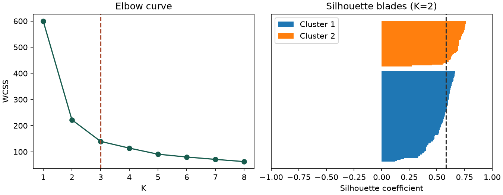
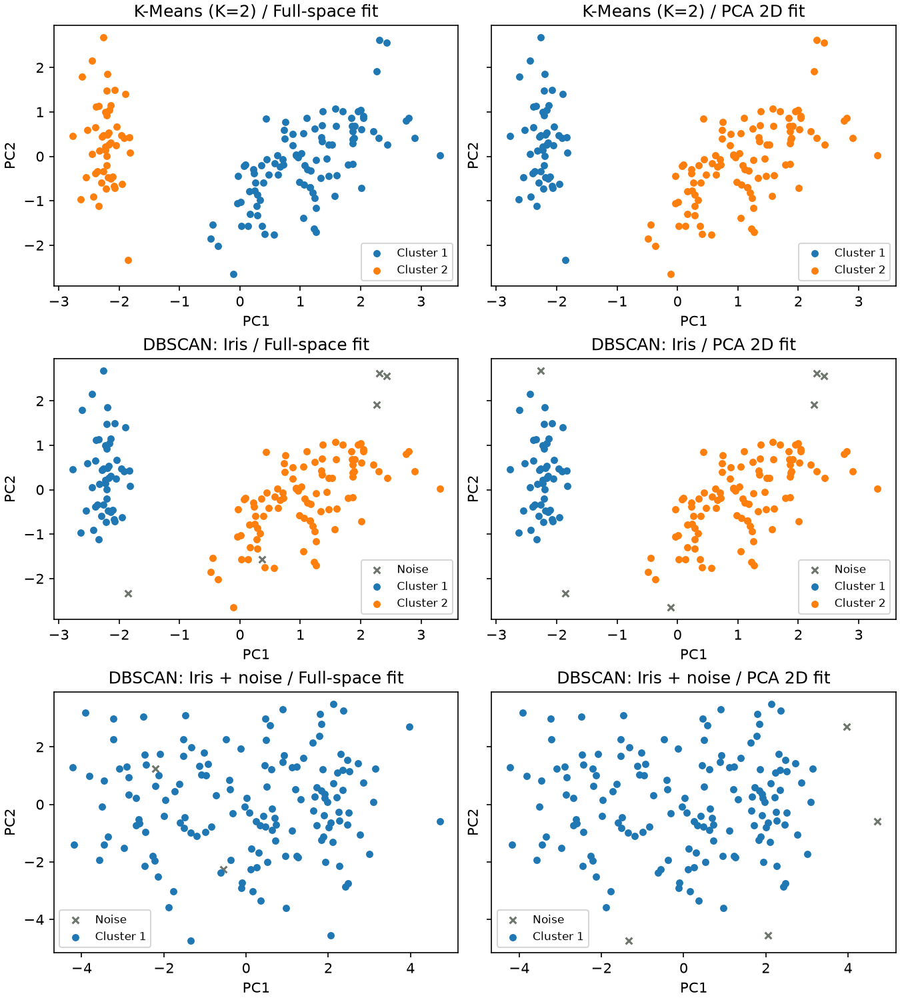

# 作业五 · 无监督学习

## ① WCSS 的成对距离等价形式

先算每个点到质心的距离。簇里有 $n$ 个点，质心 $\mu=\frac1n\sum_i x_i$，所以展开平方后，交叉项里的 $\sum_i x_i$ 可以直接换成 $n\mu$。

$$
\sum_i\lVert x_i-\mu\rVert^2
=\sum_i\lVert x_i\rVert^2-n\lVert\mu\rVert^2.
$$

再换成点和点之间的距离。固定一个 $i$，$j$ 会跑遍全部 $n$ 个点，所以 $\lVert x_i\rVert^2$ 要加 $n$ 次。另一项也一样。

$$
\sum_i\sum_j\lVert x_i-x_j\rVert^2
=2n\sum_i\lVert x_i\rVert^2-2\left\lVert\sum_i x_i\right\rVert^2
=2n\left(\sum_i\lVert x_i\rVert^2-n\lVert\mu\rVert^2\right).
$$

括号里就是前面算出的 WCSS，所以把成对距离的平方和除以 $2n$ 就行。这里 $(i,j)$ 和 $(j,i)$ 都算进去了。

## ② Ward 聚类合并的方差增加量

合并后，每个点都要重新算一遍到新质心的距离。记 $N=n_A+n_B$，新质心是 $\mu=(n_A\mu_A+n_B\mu_B)/N$。拿 $A$ 里的点来说，$x-\mu$ 可以拆成 $(x-\mu_A)+(\mu_A-\mu)$。把平方加起来时，$\sum_{x\in A}(x-\mu_A)=0$，交叉项就抵消了。$B$ 也用同样的算法。

$$
\Delta ESS=ESS(A\cup B)-ESS(A)-ESS(B)
=n_A\lVert\mu_A-\mu\rVert^2+n_B\lVert\mu_B-\mu\rVert^2.
$$

把新质心的式子代进去，得到 $\mu_A-\mu=(n_B/N)(\mu_A-\mu_B)$ 和 $\mu_B-\mu=-(n_A/N)(\mu_A-\mu_B)$。两项相加后，系数就剩 $n_A n_B/N$。

$$
\Delta ESS=\frac{n_A n_B}{n_A+n_B}\lVert\mu_A-\mu_B\rVert^2.
$$

## ③ 维度灾难与前置处理

可以想象原来只有花瓣长度和宽度，后来又加了很多和品种无关的列。算欧氏距离时，这些列也要加进去。如果各列大致独立、尺度相近，平方距离的均值大致随维数增长，标准差却只随维数的平方根增长。这样一来，远点和近点的相对差距就没那么明显了。K-Means 算距离时容易被这些无关列带偏。DBSCAN 的 ε 也会变得难选，设小了很多点找不到足够的邻居，设大了又容易把几簇接起来。

我会先统一各列的尺度，再看看哪些列有必要留下。列太多时可以试 PCA，稀疏数据也可以试 TruncatedSVD。如果更关心两个向量的方向，可以试余弦距离，稀疏二值特征则可以比较 Jaccard 距离。降到二维之后还得看看邻居有没有变，因为变化最大的方向未必最能分开几簇。

## ④ Iris 聚类实战

这里用 Iris 的 150 条记录。先把四个测量特征做 Z-score，然后把 K-Means 的 $K$ 从 2 试到 8，每个 $K$ 换 20 次初始中心。等聚完类，再拿品种标签算 ARI，看看分组和品种对得上多少。



左图里，WCSS 从两簇变成三簇时降得还比较明显，再往后就缓下来了。用归一化曲线到首尾连线的距离来找拐点，得到 **K=3**。右图用的是 **K=2**，因为它的平均轮廓系数最高（0.5817），这里就按这个指标选两簇。刀片越高，里面的点越多，虚线是平均轮廓系数。



左边先用完整特征聚类，再把结果画到 PCA 平面上。右边先做 PCA，再用这两个主成分聚类。对原始 Iris 来说，前两个主成分保留了 95.81% 的方差。选 $K=2$ 时，两种 K-Means 的 ARI 都是 0.5681。

DBSCAN 里我把 `min_samples` 设成 5。ε 用各空间第 5 近邻距离的第 90 百分位，找近邻时把点自己也算进去。原始四维和 PCA 二维都分出两簇，ARI 从 0.5503 降到 0.5379。

再往 Iris 里加 100 列独立正态噪声，距离跨度从 1.3915 掉到 0.1694，点与点之间的距离确实挤到一起了。做 PCA 后，距离重新拉开了一些，但前两个主成分只解释 6.79% 的方差。按前面那套 ε 取法，加噪后的 104 维数据和它的二维 PCA 版都只分出一簇，ARI 接近 0。

相对距离跨度为成对距离的第 90 与第 10 百分位之差除以中位数。完整数值见 [实验结果表](results.md)。

## 复现

```sh
python -m pip install -r requirements.txt
python -W error analysis.py
```

脚本读取 [scikit-learn 内置 Iris 数据](https://scikit-learn.org/stable/modules/generated/sklearn.datasets.load_iris.html)，生成两张 PNG 图和 `results.md`。随机种子为 42。
