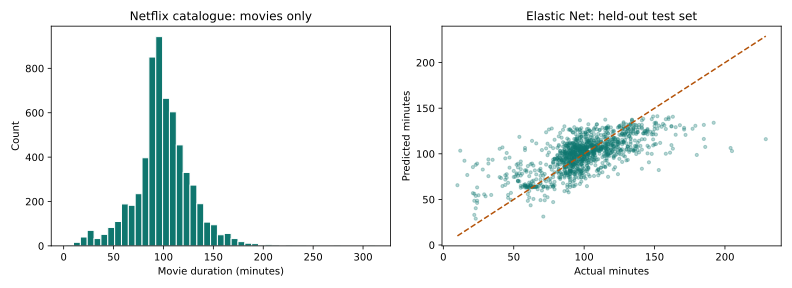
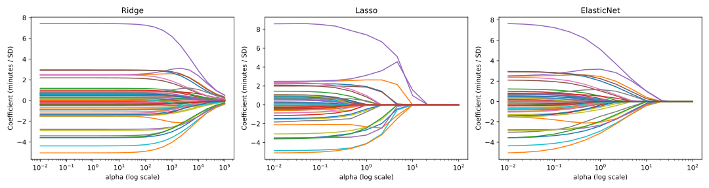

# 正则化回归交互式：Netflix 电影时长分析

## 1. 问题与数据

这次想看看，知道一部电影的年份、国家、类型和演职员数量后，能否大致估计它有多长。数据用的是 Kaggle 上的 [Netflix Movies and TV Shows](https://www.kaggle.com/datasets/shivamb/netflix-shows)，下载于 2026-11-25，其中收录作品的上映年份截至 2021 年。

原始数据有 8,807 条，其中电影 6,131 条、电视剧 2,676 条。三部电影的时长不能解析为分钟数，因此不参与回归，最终使用 6,128 部电影。电影时长均值为 99.58 分钟，中位数为 98 分钟，范围为 3–312 分钟。

整理数据时需要注意两列：`rating` 记录的是 TV-MA、PG-13 等内容分级；`duration` 对电影记录分钟数，对电视剧记录季数。因为单位不同，电视剧没有放进这次回归。

## 2. 变量与处理

要预测的是电影时长，单位为分钟。输入分成两类：一类是上映年份、演员数、导演数、国家数和类型数，另一类是主要国家、主要类型和内容分级。演员名单为空时，先记为缺失，再用训练折的中位数填补。主要国家和类型取原字段的第一个值，处理起来比较简单，不过也会漏掉合拍片和多类型作品的一些信息。

按随机种子 42 划分 4,902 个训练样本和 1,226 个测试样本。缺失值填补、稀有类别合并、独热编码和 Z-score 标准化在每个交叉验证训练折内拟合，不提前使用验证折或测试集的统计量。最终编码后有 54 个特征。

片名、编号和原始时长都不作为输入。编码后的各列做 Z-score 标准化，让惩罚不至于受变量量纲影响；截距不参与惩罚。

## 3. 模型和参数选择

Ridge、Lasso、Elastic Net 使用相同的 10 折划分，以 CV MSE 最小为标准选参数。使用完整 Pipeline 的 GridSearchCV，确保预处理也在折内完成。Elastic Net 同时调整 alpha 和 l1_ratio。alpha 表示总体正则化强度，l1_ratio 表示 L1 项占比。

交叉验证选出的 Elastic Net 参数为 alpha = 0.0464159，l1_ratio = 0.5，CV RMSE 为 20.96 分钟。这个组合同时保留了 L1 的变量筛选作用和 L2 的收缩作用。

除了误差最小的组合，还按 1-SE 规则选了一个更简单的模型：把最小 CV MSE 加上该点标准误作为上限，在这个范围内优先选非零系数少的组合；数量相同时，再选 alpha 更大的组合。Elastic Net 的 MSE 上限为 456.2551，对应 alpha = 0.464159、l1_ratio = 0.9。这样可以看看，少保留一些变量需要付出多少预测误差。

## 4. 实际结果

RMSE、MAE 的单位均为分钟；R² 越接近 1 表示解释度越高。下表中的正式测试集在调参阶段保持独立。

| 模型 | RMSE | MAE | R2 | 非零系数 | alpha | l1_ratio | CV RMSE |
| --- | --- | --- | --- | --- | --- | --- | --- |
| Mean baseline | 26.6092 | 19.1267 | -0.0002 | 0 | — | — | — |
| Ridge | 19.8164 | 14.5033 | 0.4453 | 54 | 100.0000 | — | 20.9603 |
| Ridge (1-SE) | 19.9547 | 14.5645 | 0.4375 | 54 | 2154.4347 | — | 21.3149 |
| Lasso | 19.8090 | 14.4863 | 0.4457 | 50 | 0.0464 | 1.0000 | 20.9629 |
| Lasso (1-SE) | 19.8337 | 14.4301 | 0.4443 | 36 | 0.4642 | 1.0000 | 21.0953 |
| ElasticNet | 19.8041 | 14.4900 | 0.4460 | 52 | 0.0464 | 0.5000 | 20.9585 |
| ElasticNet (1-SE) | 19.8344 | 14.4406 | 0.4443 | 39 | 0.4642 | 0.9000 | 21.1019 |

Elastic Net 的测试 RMSE 为 **19.80 分钟**，MAE 为 **14.49 分钟**，R² 为 **0.446**。如果每部电影都只猜训练集的平均时长，RMSE 是 26.61 分钟；加入这些特征后，RMSE 降低了约 25.6%。改善比较明显，但平均绝对误差仍有十几分钟，用来估计大致时长还可以，精确到单部电影就不够了。

三种回归的测试 RMSE 很接近，差距不到 0.02 分钟。Elastic Net 在这次划分下略低一些，但这个差距很小，还不足以说明它一直优于 Ridge 或 Lasso。

误差最小的 Elastic Net 保留了 52 个非零系数，1-SE 版本保留 39 个，后者的测试 RMSE 为 19.83 分钟。少了 13 个系数，误差只增加约 0.03 分钟。如果希望模型更精简，1-SE 版本是一个值得考虑的选择。这里数的是独热编码后的列，不是原始字段。

## 5. 系数与正则化路径

下面列出 Elastic Net 中绝对值最大的 10 个非零系数。数字单位是特征变化一个标准差所关联的分钟变化量。

| feature | coefficient |
| --- | --- |
| cat__primary_country_India | 7.4748 |
| cat__rating_TV-Y | -4.8693 |
| cat__primary_genre_Stand-Up Comedy | -4.2400 |
| num__release_year | -3.4604 |
| cat__rating_TV-Y7 | -3.3945 |
| cat__primary_country_United States | -2.9215 |
| cat__primary_genre_Action & Adventure | 2.9104 |
| cat__primary_genre_Dramas | 2.8845 |
| cat__primary_genre_Movies | -2.8360 |
| cat__primary_genre_Documentaries | -2.7614 |

系数较大的项目包括主要国家为印度、儿童内容分级和脱口秀类型。它们在这份数据中与电影时长有较强的关联。不过，这些是标准化后的系数，不能直接读成两个国家相差多少分钟。完整独热编码也没有单独设一个参考国家，类别频率和正则化都会影响系数的分配。这里能讨论的是关联，还不能作因果解释。

路径在训练集上计算。Elastic Net 的 l1_ratio 固定为正式模型选择的值，只改变 alpha。Lasso 与 Elastic Net 的一部分系数会被压到零；Ridge 通常连续收缩系数。三种方法的损失归一化不同，横轴相同的 alpha 不能当作完全等价的惩罚。

## 6. 交互实验与局限

运行 `python -m streamlit run app.py` 后，可以拖动 alpha 和 l1_ratio 的滑块，对照查看误差和系数的变化。这部分另从训练集划出验证数据，页面上的调参误差来自验证集，测试集留给最后的模型比较。

这次模型还有几个明显的不足。首先，国家和类型只取了第一个值，信息用得比较粗。其次，目录中的缺失资料和收录范围可能带来偏差。训练和测试又是随机划分的，同系列、同导演的作品可能同时出现在两边，所以现在的分数更适合说明同一片库里的预测表现。如果下一步要预测新上映的电影，更合适的做法是按年份划分，再单独检查不同类型电影的误差。

从结果来看，这些目录信息确实能帮助估计电影时长。Elastic Net 的作用更多体现在预测和变量筛选之间的取舍：这次用 1-SE 规则少保留了 13 个系数，预测误差几乎没有变化。比起三种模型之间很小的分数差，这个结果更值得关注。运行参数、数据校验值和环境版本记录在 `results/manifest.json`。
